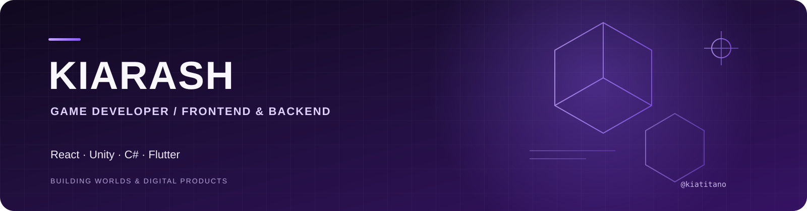

  

  <a href="https://instagram.com/kiatitano">Instagram</a>
  &nbsp;·&nbsp;
  <a href="https://youtube.com/@kiatitano">YouTube</a>
  &nbsp;·&nbsp;
  <a href="https://github.com/kiatitano">GitHub</a>

## About

I’m Kiarash, a developer working across game development, web, and mobile apps. I enjoy building interactive experiences and useful products, from Unity gameplay systems to full-stack applications.

## What I Work With

- **Game development:** Unity, C#, gameplay systems, and developer tools
- **Web development:** PHP, JavaScript, HTML, and CSS
- **Mobile development:** Flutter and Dart
- **Product engineering:** APIs, integrations, and desktop utilities

## Featured Projects

- **[Titano Trigger](https://github.com/kiatitano/titano-trigger)** — A Windows tool that turns live Reymit donations into timed keyboard or mouse actions.
- **[Unity CompassBar](https://github.com/kiatitano/Unity-CompassBar)** — A Unity C# compass UI with mission markers.

## Connect

For collaborations or project conversations, reach me through [Instagram](https://instagram.com/kiatitano) or [YouTube](https://youtube.com/@kiatitano).
