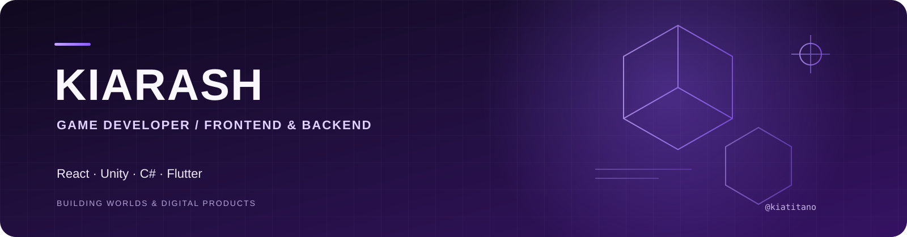

  

  <a href="https://instagram.com/kiatitano">Instagram</a>
  &nbsp;·&nbsp;
  <a href="https://youtube.com/@kiatitano">YouTube</a>
  &nbsp;·&nbsp;
  <a href="https://github.com/kiatitano">GitHub</a>

## About

I’m Kiarash, a game developer and frontend/backend developer. I build interactive games and modern web and mobile products, working with React and current web technologies.

## What I Work With

- **Game development:** Unity, C#, gameplay systems, and developer tools
- **Frontend:** React, JavaScript, modern web technologies, and responsive interfaces
- **Backend:** Server-side applications, APIs, and integrations
- **Mobile:** Flutter and Dart

## Featured Projects

- **[Titano Trigger](https://github.com/kiatitano/titano-trigger)** — A Windows tool that turns live Reymit donations into timed keyboard or mouse actions.
- **[Unity CompassBar](https://github.com/kiatitano/Unity-CompassBar)** — A Unity C# compass UI with mission markers.

## Connect

For collaborations or project conversations, reach me through [Instagram](https://instagram.com/kiatitano) or [YouTube](https://youtube.com/@kiatitano).
